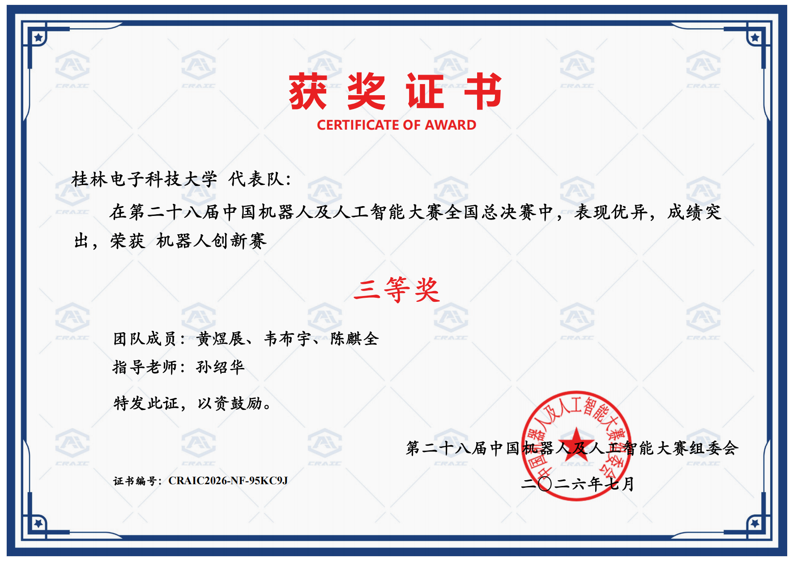

# LidarCar Team｜低空无人机智慧救援（中国机器人及人工智能大赛 国赛三等奖）

> 三人协作的空地联动机器人项目。仓库按**赛题—模块—联调—验证**组织：先理解任务和接口，再进入小车、无人机或视觉的实现与测试材料。

**项目定位：** 小车控制器为 **MSPM0G3507**。系统目标是完成无人机巡航识别、救援包投放、无线目标信息传递、救援车自主到点与返航，以及参赛电脑的目标信息显示。

## 获奖荣誉

<p align="center">
  <a href="docs/assets/awards/2026年机器人创新赛全国总决赛三等奖.jpg">
    
  </a>
  <br>
  <sub>2026年7月 · 点击证书查看原图</sub>
</p>

## 快速导航

<details open>
<summary><strong>按需要查找资料</strong></summary>

| 想做什么 | 从这里开始 | 说明 |
| --- | --- | --- |
| 按中文名称查找所有文档 | [中文资料总目录](docs/README.md) | 比赛、雷达小车、无人机、视觉与团队协作分类索引。 |
| 先看赛题、场地和得分项 | [赛题与评分](docs/competition/) | 任务闭环、地图尺寸、100 分矩阵与赛前核对。 |
| 看三端如何交接 | [空地通信约定](docs/competition/空地联调通信约定.md) | AS32、9 字节目标帧、坐标边界和联调规则。 |
| 接手雷达小车 | [雷达小车](car/) → [控制与开发资料](car/docs/README.md) | MSPM0G3507、PinMux、PCB、路径控制和测试材料。 |
| 开始无人机或视觉工作 | [无人机飞控](aircraft/) / [视觉与投递](vision/) | STM32F407 飞控源码、MaixCam Pro 视觉源码、板载串口协议与各自的资料边界。 |
| 核对雷达小车 PCB 与接线 | [小车硬件资料](car/hardware/) | 原理图、版本与板测材料。 |
| 看当前验证范围 | [项目资料与验证状态](docs/项目资料与验证状态.md) | 分清已确认、台架、现场与阶段记录。 |
| 阅读项目复盘 | [项目复盘笔记](docs/团队项目复盘笔记.md) | 留给成员记录关键转折、协作和第一次获奖经历。 |

</details>

## 当前状态

| 模块 | 负责人 | 当前内容 | 需要补齐 |
| --- | --- | --- | --- |
| [雷达小车](car/) | haimichenha | MSPM0G3507 阶段控制文件、引脚表、原理图、A/B 联调预览与协议约定 | 完整工程、版本化 `.syscfg`、PCB 板测和与赛题同轮的实车记录。 |
| [无人机](aircraft/) | 黄总 | 已迁入 `ANO_LX` STM32F407 飞控源码快照、Keil 工程和阶段开发记录。 | 与当前机体一致的构建、烧录、接线、飞行状态与飞行证据。 |
| [视觉与投递](vision/) | 韦少 | 已迁入 MaixCam Pro 的 `main.py`：AprilTag 识别、坐标换算、串口交接与舵机状态机。 | 模型/设备版本、相机标定、舵机行程和现场投放证据。 |

状态标签见 [项目资料与验证状态](docs/项目资料与验证状态.md)：`planned`、`team-confirmed`、`bench-verified`、`field-verified`、`stage-record`。它们表示资料的验证范围，不是成绩预估。

## 系统分工与任务闭环

```text
无人机：巡航 / 识别二维码 / 投放 / 返航
                  │ 无线目标编号与坐标
                  ▼
救援车：接收 → 坐标转换 → 规划避障 → 到点 / 返航
                  │
                  └────────→ 参赛电脑：目标与坐标显示
```

- **小车**维护定位、规划、底盘驱动、停车和本地安全判断；不能把无人机或视觉消息直接当作电机安全结论。
- **无人机**维护飞控、机载通信、飞行阶段与飞行验证；已归档的 `ANO_LX` 工程以 STM32F407 为目标，飞控逻辑不由小车或视觉目录单方面修改。
- **视觉与投递**维护识别、结果接口、舵机投递及其验证；已归档 MaixCam 程序的板载串口帧不等同于空地 AS32 的 9 字节目标帧，二者的分层关系见 [视觉目录](vision/)。
- 跨模块的消息、坐标或触发条件变更，先更新 [团队职责与接口](docs/团队分工与接口约定.md) 与 [通信约定](docs/competition/空地联调通信约定.md)，再修改各自代码。

## 仓库规则

1. **赛题先行。** 尺寸、评分和流程以 [赛题与评分](docs/competition/) 为准；实现前先写清本轮对应的判据。
2. **模块归位。** 小车资料留在 `car/`，无人机资料留在 `aircraft/`，视觉/投递资料留在 `vision/`；没有实际共用且可复核的材料，不单设泛化目录。
3. **阶段记录不等于现场通过。** 旧文件、图片和单段视频只在记录的版本与条件下成立。改硬件、改场地或改协议后，重新取得对应证据。
4. **一次只改一层。** 按硬件/PinMux、日志、坐标、规划、速度执行和联调逐层验证，避免跨层混改。
5. 提交前执行 [协作与变更规则](CONTRIBUTING.md) 中的最小检查；不提交构建产物、凭据、模型权重、原始大视频、运行日志或 IDE 私有状态。

## 文档入口

- [赛题、场地与评分](docs/competition/)：任务闭环、场地、得分矩阵和素材入口。
- [中文资料总目录](docs/)：按用途查找所有说明文档，以及团队职责、验证状态和项目复盘。
- [雷达小车](car/)：MSPM0G3507 控制、硬件与小车测试材料。
- [无人机](aircraft/)：STM32F407 `ANO_LX` 工程、构建入口、导入记录与后续飞行验证落点。
- [视觉与投递](vision/)：MaixCam Pro 程序、板载视觉—飞控协议和标定/投递验证落点。
- [参与协作](CONTRIBUTING.md)：模块化提交的最小记录。
