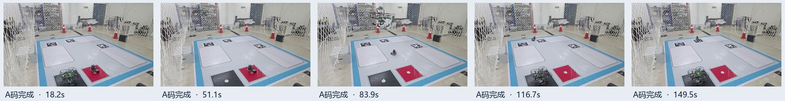

# A/B 联调与返航视频证据索引

**状态：`reference`。** 本目录保存四段历史联调视频的联系表缩略图和完整性清单。缩略图可用于仓库预览；原始 MP4 未提交，以避免普通 Git 历史增加约 1.09 GiB 的二进制文件。

## 可提交预览

| 证据编号 | 联系表 | 原始视频文件名 |
| --- | --- | --- |
| A 完成 | [预览](a-code-complete-contact.jpg) | `A码完成.mp4` |
| B 完成 | [预览](b-code-complete-contact.jpg) | `B码完成.mp4` |
| A 返航 | [预览](a-code-return-contact.jpg) | `a码，联调成功成功返回.mp4` |
| B 返航 | [预览](b-code-return-contact.jpg) | `8号，b码成功联调返回.mp4` |

## 原始视频清单

原始文件保留在 haimichenha 的受控本地归档。其名称、大小和 SHA-256 如下，可在需要发布附件、Git LFS 或外部存储时核对。

| 原始文件名 | 大小（bytes） | SHA-256 |
| --- | ---: | --- |
| `A码完成.mp4` | 462,563,756 | `58a736f52d58b4d2dea127c2ff38d6708ac38e25a95a5feaeff85ed5633ac74f` |
| `B码完成.mp4` | 348,370,923 | `795f789d83ad432d44764ab0ef75d6f94ee6b1a19e375da1625b584bb3decb50` |
| `a码，联调成功成功返回.mp4` | 196,044,959 | `dd3dc0c16fdea29ff99f68de45d61833f1b0bc437b82f19850f6331dc80871de` |
| `8号，b码成功联调返回.mp4` | 158,841,729 | `fba17e7ded5a0fc569fb467b7725240eb223922df6b34626300245d4509cdec2` |

联系表来自本地 `ppt creating/images/video_frames_20260710/`，每张缩略图与来源文件的哈希记录如下：

| 联系表 | SHA-256 |
| --- | --- |
| `a-code-complete-contact.jpg` | `d02206ba072ed3294fe9daeeb339b697f5b5ed96206efd0fea334075566ba1fa` |
| `b-code-complete-contact.jpg` | `31e4eeab8da169369b9a6e824b211576b51fdf9306cf1aa53c9c6291a128b941` |
| `a-code-return-contact.jpg` | `4ea9c5905e2d635b69723f0b2522f48c08fb650a3d8c4a3a0d6418555b99914a` |
| `b-code-return-contact.jpg` | `5823307a40ef8c3fdb7eec4b3af914233f3f7d634826ae1c1009fc29db7b0d72` |

## 证据边界

这些材料证明对应历史视频文件和预览索引可追溯；它们不替代当前固件、地图、PCB 版本、串口/冻结日志和重复实车测试。需要在公开仓库播放时，先由 haimichenha 选择发布附件、Git LFS 或授权的外部存储，并在本文件补充稳定链接与发布版本。
