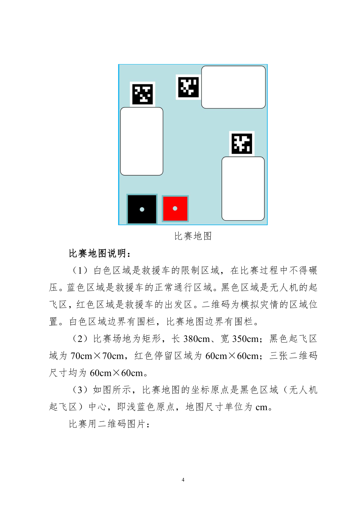
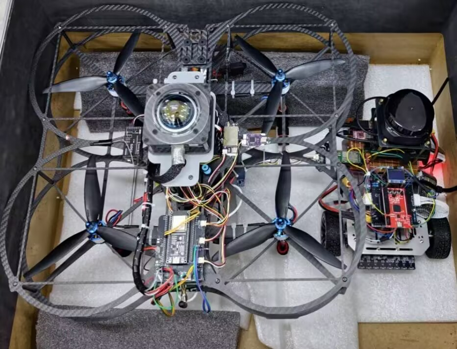

# 低空无人机智慧救援：赛题、场地与评分

> 本页把比赛通知中与本项目直接有关的任务、场地和评分要求整理成可翻阅入口。**官方通知是唯一评分依据；仓库中的照片、历史视频和代码快照只能说明材料来源，不能自动换算成得分或验收结论。**

<details open>
<summary><strong>目录</strong></summary>

- [题目与任务闭环](#task-loop)
- [场地与尺寸](#field)
- [评分与证据矩阵](scoring-matrix.md)
- [空地联调通信约定](communication-contract.md)
- [材料、图片与视频入口](#materials)

</details>

<a id="task-loop"></a>
## 题目与任务闭环

比赛为“低空无人机智慧救援”专项赛：无人机从黑色起飞区起飞，在蓝色比赛区域内巡航；从 A、B、C 三张二维码中选择一个识别，获取其位置，在二维码上方投放救援包，并把二维码位置信息通过无线通信发送给救援车。救援车从红色出发区出动，到目标二维码中心；无人机则返航并在黑色起飞区降落。两者均完全停在对应区域的时刻，才是该轮流程的截至时间。

这不是“飞机完成了、小车随后自己跑”的两段展示，而是一条应当闭合的链路：

```text
无人机巡航 / 识别二维码
        ↓  无线发送：二维码编号 + 目标坐标
小车接收 → 坐标转换 → 路径规划 / 避障 → 到二维码中心停车
        ↓
无人机投放并返航降落；参赛电脑显示目标信息与坐标
```

小车只能在将无线帧中的飞机原始坐标转换为比赛地图坐标后，才把目标交给路径规划。帧格式、AS32 链路、字节序和转换边界见 [空地联调通信约定](communication-contract.md)。

<a id="field"></a>
## 场地与尺寸

<p align="center">
  
</p>

*图：通知附件中的比赛地图阅读版；原始页见下方 PDF。*

| 项目 | 题面定义 | 对实现的直接影响 |
| --- | --- | --- |
| 比赛地图 | 矩形，长 `380 cm`、宽 `350 cm` | 统一地图坐标与路径边界的基准。 |
| 黑色区域 | 无人机起飞区，`70 cm × 70 cm` | 无人机需要在该区域内返航、稳定降落。 |
| 红色区域 | 救援车出发/返回区，`60 cm × 60 cm` | 小车从此区出发；评分项还要求返回其中心并停留。 |
| 二维码 | A、B、C 各 `60 cm × 60 cm`，表示模拟灾情点 | 目标点的判据是二维码中心，不是“靠近二维码”。 |
| 浅蓝色区域 | 救援车正常通行区域 | 地面路径规划与禁区约束的基础。 |
| 白色区域与边界 | 救援车限制区域，白色区域边界有围栏 | 车轮不得碾压/触碰；不能用压线完成短路径。 |
| 地图坐标原点 | 黑色起飞区中心（图中浅蓝色点） | 记录“飞机坐标 → 地图坐标”转换时必须明确原点、方向和单位。 |

评分条款还要求救援车途中不得触碰地图外侧蓝色边界线或内部白色限制区域边界。不要将“浅蓝色可通行”误读成可以越过场地图边线。

## 设备与流程硬约束

| 约束 | 要点 |
| --- | --- |
| 参赛形式 | 以实物系统呈现，围绕无人机与救援车空地联动完成识别、定位、信息传输、地面导航与投放。 |
| 无线通信 | 无人机、救援车与参赛电脑之间采用无线通信；这是独立的 5 分项。 |
| 无人机 | 使用开源飞控；必须有桨叶保护圈和紧急安全装置；轴距小于 `45 cm`。 |
| 救援车 | 长、宽不超过 `35 cm × 30 cm`。 |
| 计时 | 从无人机解锁开始；`≤ 420 s` 获时间项满分，超过 `470 s` 时间项为 0。 |
| 调试窗口 | 设备开机、调试和比赛过程合计不得超过 `15 min`。 |

完整分值、逐项判据和当前材料缺口见 [100 分评分与证据矩阵](scoring-matrix.md)，其中把“题面要求”和“仓库现有材料”分开写，避免把一张照片或历史片段误当成成绩单。

<a id="materials"></a>
## 材料、图片与视频入口

| 材料 | 用途与边界 |
| --- | --- |
| [官方通知及附件（PDF）](assets/competition-notice-2026-guangxi.pdf) | 文件全名为《第 28 届中国机器人及人工智能大赛广西赛区暨第 5 届广西机器人及人工智能大赛通知》；本页题目、场地、评分和尺寸均以其中“低空无人机智慧救援”专项赛及附件为依据。SHA-256：`8909C0C79DAD9C35B08A34F18A092E8AABDEC2261C8BCFA6C52CD2CB5345B09B`。 |
| [官方评分表图](assets/official-score-sheet.png) | 便于快速对照版式；文本化、可检索的完整条目见 [评分矩阵](scoring-matrix.md)，原始依据仍是 PDF。 |
| [小车与无人机归档视图](assets/vehicle-and-aircraft-view.jpg) | 仅说明当时硬件的外观与组合状态；不据此推导尺寸合规、通信成功或任务完成。 |
| [项目提供的外部视频资料](https://pan.baidu.com/s/1ynyjWyGLR6IYjEXc92roYQ?pwd=ewr4)（提取码：`ewr4`） | 项目视频入口。逐段补入日期、版本、场地与通过判据前，它保持 `stage-record` 状态。 |

<p align="center">
  
</p>

### 阅读与维护约定

1. 赛题数字、尺寸、扣分条件发生争议时，回看 PDF 对应附件，不在聊天记录或截图上二次猜测。
2. 协议或坐标转换改动，必须同步更新 [通信约定](communication-contract.md)、小车和无人机的接口记录及同轮日志/视频。
3. 新照片或视频应附日期、硬件/固件版本、操作和观察结果；没有这些元数据，就只做展示材料，不升级验证等级。
